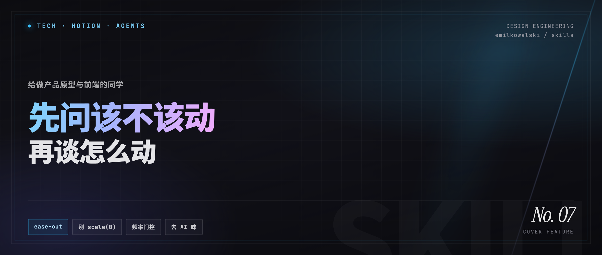

# Agent 出的页面总是「能用但不好用」？这个 Design Skill 专治 AI 味动效



> 给做产品原型和前端的同学：什么时候该动、怎么动、什么绝不动。

---

## 太长不看

**一句话：** Agent 会写动效代码，但不会判断手感。Emil Kowalski 的 skills 把「该不该动、怎么动」编码成可执行规则，专治 AI 味界面。

**装这个：**

```bash
npx skills@latest add emilkowalski/skills
```

仓库：https://github.com/emilkowalski/skills（注意是 `skills` 复数，网上常写成单数 `skill`）

**六个 skill 怎么选：**

| 场景 | 用哪个 |
| --- | --- |
| 日常写 UI / 动效 | `emil-design-eng` |
| 不知道该不该加动画 | `find-animation-opportunities` |
| PR / 出活前审查 | `review-animations` |
| 整页动效太乱要治理 | `improve-animations` |
| 说不清「那种弹一下」 | `animation-vocabulary` |
| 要 sheet / 手势 / 流体感 | `apple-design` |

**只记三条规则：**

1. **频率决定要不要动** — 快捷键、命令面板等超高频路径：**不要动画**
2. **进场用 ease-out，别用 ease-in** — 用户盯的是「有没有立刻动」
3. **不要 `scale(0)`；popover 从 trigger 长出来** — Modal 居中除外

**最小行动（10 分钟）：** 对最近一页 Agent 生成的 UI 说——

> 什么该动、什么不该动？拒绝项必须写。最多 5 条建议。

**不是什么：** 不是一键美化滤镜；装了不会自动变好看。价值一半在**克制**，一半在标准。

---

## 你一定见过这种「能用」

Agent 帮你出了一版 settings、一个下拉菜单、一个确认弹窗。

能点、能跳、能演示——但总差点意思：

- 按钮按下去没反馈，像点在平面海报上
- 弹层从屏幕正中「冒」出来，和触发按钮毫无关系
- 下拉用了 `ease-in`，前半段发闷，后半段才冲出来
- 命令面板、快捷键操作也配了华丽开场动画，用几次就觉得拖

产品同学拿去路演，观众说「挺完整」。  
前端同学拿去 review，心里只有一句：**像 AI 写的。**

问题往往不在「会不会写动画」，而在：**有没有一套可执行的手感标准。**

Agent 会写动效代码，但还不太会判断 *feel*。  
[Emil Kowalski 的 skills](https://github.com/emilkowalski/skills)，就是把这种判断编码成了 Agent 能遵守的规则。

---

## 为什么 Agent 特别容易写出「AI 味」界面

### 1. 会写代码 ≠ 知道手感

它知道 `transition`、`scale`、`keyframes`，却经常选错「配方」：

- 进场该用 **ease-out**（先快后慢，立刻有响应），却写成 **ease-in**
- 元素从 **`scale(0)`** 长出来——现实里没有东西是从「绝对虚无」蹦出来的
- 给一天要用上百次的操作也加动画，让高频路径变慢、变钝

### 2. 小细节会复利

单独看，每一处都「不算 bug」。  
叠在一起，就是你说不清、但用户一秒就能感到的廉价感。

Emil 自己的判断很直白：**Agents don't have great taste。**  
Skill 的意义，不是取代设计师，而是把领域经验放大到每一次生成和审查里。

### 3. 原型和前端，其实是同一刀

原型阶段如果定错了运动语言（到处弹、到处 fade、到处 400ms），后面只有两条路：

- 前端照搬，产品全程 AI 味
- 前端推倒重做，白白多一轮沟通

所以这套 skill **不只适合写 CSS 的人**——做高保真原型、用 Agent 出可交互稿的同学，同样用得上。

---

## 它是什么，又不是什么

| | 说明 |
| --- | --- |
| **是什么** | 给 coding agent 用的 Design Engineering Skills，约束 UI / 动效决策 |
| **谁做的** | Emil Kowalski（Sonner、Vaul 作者；背景含 Vercel、Linear） |
| **怎么装** | 见文首「太长不看」或下方命令 |
| **不是什么** | 不是 Figma 插件，不是组件库，不会一键「美化全站」 |

它提供的是三件事：

1. **规则**——频率、easing、时长、origin、性能与无障碍  
2. **审查**——按高标准 flag 问题，默认不轻易放行  
3. **工作流**——先找机会 / 再审计 / 再执行，分析与改代码可拆开

> 社区里常把它和 Impeccable、Taste 等 skill 并列：别人管版式与「去模板感」，Emil 这条线更擅长 **motion 与克制**。

### 安装

```bash
npx skills@latest add emilkowalski/skills
```

兼容 Claude Code、Cursor、Codex 等常见 Agent 环境（以 Skills CLI 当前支持为准）。

**注意：** 网上不少转载写成 `emilkowalski/skill`（单数），仓库名是 **`skills`（复数）**。

仓库地址：https://github.com/emilkowalski/skills

---

## 六个 skill，一张表说清「该用哪个」

不必一次全开。按场景选就行。

| Skill | 一句话 | 原型同学 | 前端同学 |
| --- | --- | --- | --- |
| **emil-design-eng** | 主 skill：动效哲学 + 组件手感 | 生成交互时的默认品味 | 写组件时的常驻约束 |
| **find-animation-opportunities** | 找该动的，更要写清不该动的 | 演示前扫一遍，避免堆动画 | 需求/自查时的 shield |
| **review-animations** | 严格审查现有动效 | 对照 AI 生成的交互稿 | PR / 出活前 diff review |
| **improve-animations** | 全页/全库审计 → 可执行 plan | 少用 | 动效屎山治理首选 |
| **animation-vocabulary** | 把「那种弹一下」说成精确术语 | 和 AI / 设计对齐语言 | 写 prompt 更准 |
| **apple-design** | Apple 流体界面原则落到 Web | 做手势 / sheet 高保真 | drawer、drag、spring |

**最被低估的一句：**  
这套东西一半价值不在「多加点动画」，而在 **什么绝不动**。

键盘触发、一天上百次的路径（命令面板、快捷键切换）——**不要动画。**  
Raycast 开关没有开场动画，不是偷懒，是正确。

---

## 两条可直接照抄的工作流

### 路径 A：产品 / 原型（从 0 到可演示）

目标不是「动效最多」，而是 **演示时顺、日常用时不烦**。

1. 先让 Agent 把信息结构和状态做对，**先别急着加动画**  
2. 用 `find-animation-opportunities` 扫描，并强制输出「建议 + 拒绝项」  
3. 只采纳 **3～5 个**高杠杆动效（按钮反馈、弹层来源、列表出现等）  
4. 用 `emil-design-eng` 实现具体数值  
5. 演示前用 `review-animations` 过一遍

**可复制 Prompt：**

```text
这是设置页，用户每天会进出几十次。
请用 find-animation-opportunities 的标准，列出真正值得加动效的点；
并明确写出你拒绝了哪些候选、为什么拒绝。
最多给 5 条建议，按杠杆排序。
```

```text
这是结账流程，每会话只用几次。
找出能减少「状态跳变突兀感」的 motion 机会；
高频控件只允许极轻、极短的反馈，不要装饰性动画。
```

```text
在加任何动画之前：这个 dashboard 里，有什么东西根本不该动？
请只回答「不该动」清单和原因。
```

---

### 路径 B：前端（从能跑到觉得对）

1. **新页面刚生成**：先 shield，再动手  
2. **已有动效很乱**：`improve-animations` 出 plan，再让 Agent/自己按 plan 改（分析与执行可拆模型）  
3. **PR 前**：`review-animations`，要 Before / After / Why 表，不要散文式「感觉还行」

**可复制 Prompt：**

```text
我刚用 Agent 生成了这个 settings 页，目前几乎没有动效。
请判断：什么应该动、什么不应该动？给出具体属性、时长和 easing，不要空泛建议。
```

```text
improve-animations quick：只看高频交互组件。
按 leverage 排序，先给我 findings 表，不要直接改代码。
```

```text
用 review-animations 的标准审查当前 diff 里的动效。
输出 markdown 表：Before | After | Why。默认倾向 flag，通过需要挣到。
```

**自查清单（30 秒版）：**

- [ ] 有没有 `transition: all`
- [ ] 有没有从 `scale(0)` 进场
- [ ] UI 进场是否误用了 `ease-in`
- [ ] popover/dropdown 是否从 trigger 长出（而不是永远 center）
- [ ] 键盘 / 超高频操作是否还带着动画
- [ ] UI 动效是否普遍超过 300ms
- [ ] hover 动效是否考虑了触控设备误触发
- [ ] 是否处理了 `prefers-reduced-motion`（减弱，不是粗暴删光）

---

## 只记三条，也能立刻少踩坑

即使今天不装 skill，记住这三条，已经能挡住大半「AI 默认配方」。

### 1. 频率决定要不要动

| 出现频率 | 策略 |
| --- | --- |
| 100+ 次/天（快捷键、命令面板） | **不要动画** |
| 一天几十次（列表 hover、常见切换） | 极短、极轻，或干脆去掉 |
| 偶尔（Modal、Drawer、Toast） | 标准动效 |
| 很少 / 首次（引导、成功态） | 才有资格谈一点 delight |

### 2. 进场用 ease-out，别用 ease-in

用户盯的是「点下去之后有没有立刻动」。  
同样是 200ms，`ease-in` 会感觉比 `ease-out` 更钝——因为慢在开头。

更稳妥的自定义曲线示例：

```css
--ease-out: cubic-bezier(0.23, 1, 0.32, 1);
```

### 3. 不要从虚无出现；popover 从按钮长出来

```css
/* 差：像凭空生成 */
transform: scale(0);

/* 好：略小 + 透明，像物体进入视野 */
transform: scale(0.95);
opacity: 0;
```

弹层应锚在触发源（`transform-origin` 指向 trigger）。  
**例外：居中 Modal** 可以保持从中心出现——它本来就不是「从某个按钮长出来」的空间关系。

### Before / After 速查

| Before | After | Why |
| --- | --- | --- |
| `transition: all 300ms` | `transition: transform 200ms ease-out` | 只动画必要属性，避免误伤与掉帧 |
| `scale(0)` 进场 | `scale(0.95)` + `opacity: 0` | 现实里没有「从绝对零出现」 |
| 下拉用 `ease-in` | `ease-out` 或强自定义曲线 | 响应感来自前半段 |
| 按钮无 `:active` | `transform: scale(0.97)` | 按下要有物理反馈 |
| popover `transform-origin: center` | 使用 trigger origin（如 Radix 变量） | 空间来源要讲得通 |
| 命令面板开关带动画 | **删掉动画** | 超高频路径，动画 = 延迟 |

---

## 边界：别把它神化

诚实说局限，反而更好用：

1. **装了不会自动变好看**  
   要在对的时机调用：找机会、审查、审计。它是副驾驶，不是美图滤镜。

2. **动效只是「AI 味」的一部分**  
   版式、字体、配色、文案仍可能很模板。需要时再搭配版式/设计系统类 skill；Emil 这条线优先解决 **motion 判断**。

3. **公开 skill ≠ 课程完整版**  
   作者也提过：公开仓库很强，课程 skill 覆盖面更广；公开仓里额外突出的如 `apple-design`、`animation-vocabulary` 仍很实用。对大多数原型和业务前端，公开版足够开工。

4. **克制比花活重要**  
   若 skill 扫完告诉你「几乎不该加动画」——那是好结果，不是失败。

---

## 今天最小可行动作

任选一个，十分钟内能做完：

1. **装上 skill**，对你**最近一页** Agent 生成的 UI 跑：  
   「什么该动、什么不该动？拒绝项必须写。」
2. **不装也行**：拿上面的 8 条 checklist，打开一个 Button + 一个 Popover 自查。
3. **进阶**：把团队自己的 3 条动效规范（例如「后台系统禁止 bounce」）也写成 skill——学的是方法，不只是安装。

---

## 结语

好界面很少靠「多一个炫技动画」取胜。  
更多时候，是无数用户说不清的细节，在同一套标准下站在了一起。

Agent 已经很会交付「能用的界面」。  
差的那一层，往往是：**该不该动、怎么动、什么绝不动。**

Emil 这套 skill 的价值，是把这些判断从个人经验，变成团队和 Agent 都能执行的规则。

你不需要先成为动效专家，再去要求更好的手感。  
你可以先给 Agent 一套更好的品味约束——然后在每一次原型和每一次 PR 里，复利下去。

```bash
npx skills@latest add emilkowalski/skills
```

---

## 延伸阅读

- GitHub：https://github.com/emilkowalski/skills  
- 作者站点与 skill 更新：https://emilkowal.ski/skill · https://animations.dev/skills  
- 相关文章：[Agents with Taste](https://emilkowal.ski/ui/agents-with-taste)

---

*如果你有用这套 skill 前后的页面对比，欢迎留言——「该动 / 不该动」的真实案例，比再安利十次安装命令都有用。*
