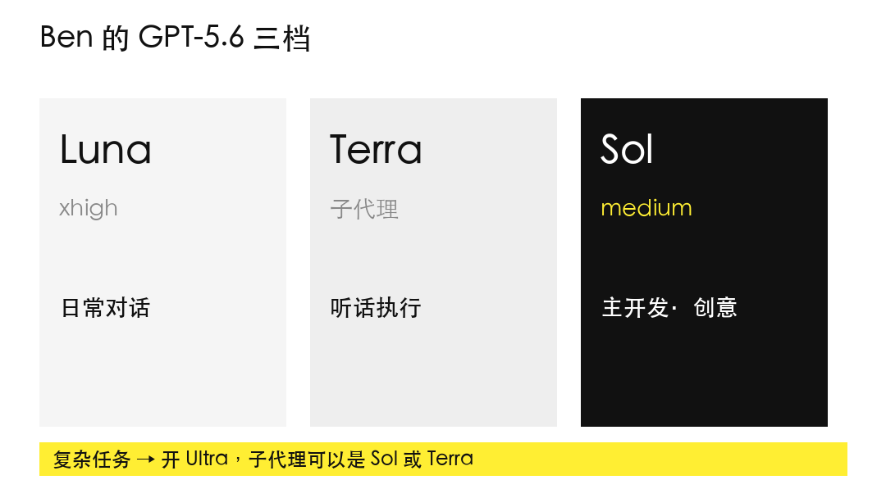
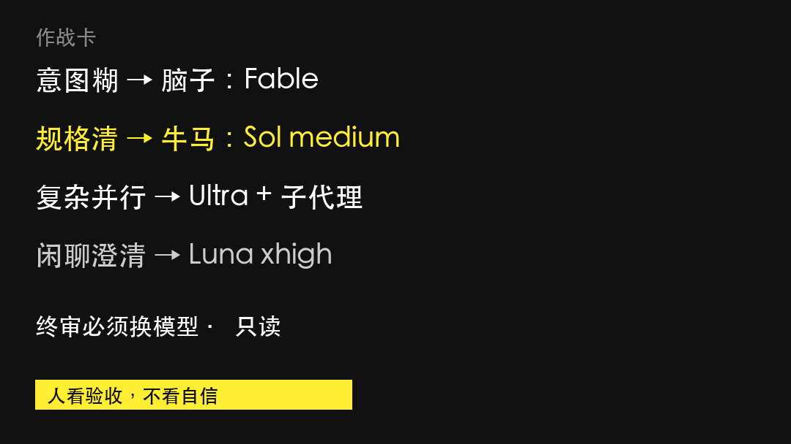

# Fable当脑子，Sol做牛马？

别比榜单。工作里只定两件事：

**谁想清楚，谁把活干完。**

---

## 01 跨栈：Fable 想，Sol 干

::: callout
**Fable 写指令。Sol 写代码。**
:::

就这一句。展开也就三步：

1. **你**说清目标、边界、不能动什么  
2. **Fable** 写成验收与风险（别让它直接改仓库）  
3. **Sol** 按指令实现（别让它自己终审）

**会话怎么开**

- 想 / 评 / 定规格 → **Fable**  
- 写 / 改 / 长跑 → **Sol**  
- 收 diff → **换模型只读**

混在一个窗口里聊到上线，等于没分工。

只剩一个名额？留 **Fable**。规格错了，牛马越卖力越惨。

---

## 02 单栈：GPT-5.6 怎么点

::: callout
**默认 Sol medium。能并行再 Ultra。闲聊才 Luna。**
:::

对照表就记这一行主线：

| 场景 | 点它 |
|------|------|
| 日常开发 | **Sol medium** |
| 大活可拆并行 | **Ultra**（子代 Sol / Terra） |
| 问一句 | **Luna** |

**Terra**：更听话，适合挂在 Ultra 下面当牛马手。  
**UI**：用 Sol，**附参考图**，别只丢形容词。

规格还糊？先回去找脑子位写清验收——**别靠加钱开 Ultra 硬刚。**

---

## 明天怎么干

**一张卡**

- 意图糊 → Fable  
- 规格清 → Sol medium  
- 收尾 → 换模型只读  
- 可并行 → Ultra  
- 闲聊 → Luna  

**本周只改一个默认值**：主开发从「随手 Ultra」改成 **Sol medium**。

::: callout
脑子想清楚。牛马干完。档位别烧穷。
:::

---

延伸：日推七种用法合集 / Kenn 写指令 / 猫头鹰 vs 罗威纳（文末链接见排版稿）
