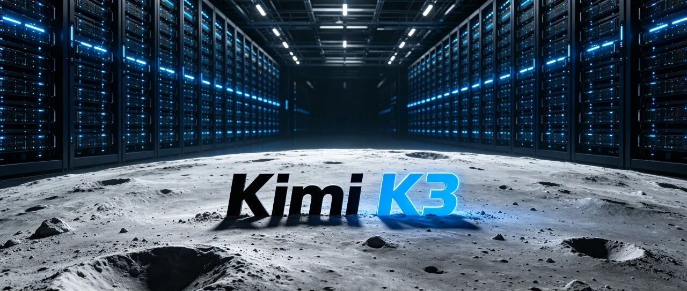
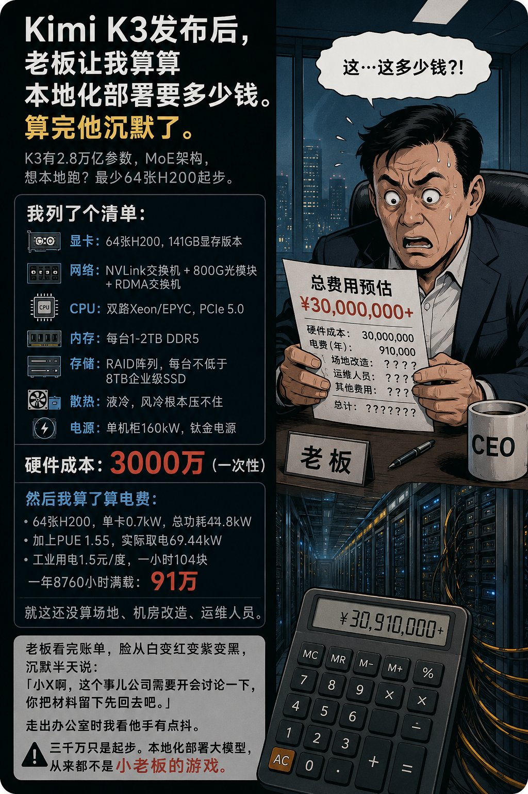
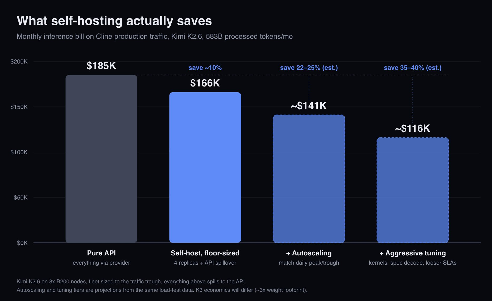

# 私有化部署 AI Coding？董事长您先坐下

> 系列：大模型落地与算力账本  
> 整理：ziikoo 研究院 · 2026-07  
> 素材：X 上公开的 Kimi K3 私有化 / 自托管成本讨论（文末附来源）

---

上个月给一家公司培训，培训结束，十个人的研发团队合上笔记本。

投影还亮着：演示里模型写代码、改单测、答业务问题，都还像样。董事长点点头：

「AI Coding 能力不错。咱们库房里有几台闲置服务器，单卡 48G 显存，私有化部署一套试试——权重不是开源了吗？」

话落，空气静了两秒。

不是泼冷水。是这句话把三个完全不同的概念叠在了一起：

1. **会用 API**（培训里大家刚学会的）  
2. **权重开放可下载**（新闻标题）  
3. **私有化部署成公司可用的服务**（真正要的）

三者之间，隔着一整条供应链：显存、互联、机房、电费、运维编制。门槛远超「普通企业用库存机试一把」。

下面把 X 上关于 **Kimi K3 权重 / 全量 / 本地 / 自托管** 的成本评估摊开——不是恐吓，是对齐量级。

---

## 一、先对齐：K3 是什么量级

社区对 K3 的常见描述（口径会随官方 README 微调，以开源日为准）：

| 项 | 社区说法 |
|----|----------|
| 总参数 | 约 **2.8T**，MoE |
| 路由 | 约 **896 选 16**，每次激活约 **500 亿** 参数 |
| 量化体量 | **MXFP4 后约 1.4TB** |
| 上下文 | 约 **100 万 token** |

@Fferr16 写得很直白：API 已经能用；「想本地跑」则是 **1.4TB 起步**，**Blackwell / MI400 才能舒适装载**。  
@StatsWire 补了一刀：人人会说 “you can run it locally”，诚实版本是——**最少 8×H100 才能把权重 load 进机器**；单张 RTX 4090，量化也跑不了。

注意两档：

- **能 load**：把参数塞进显存/统一内存，服务能起来。  
- **能当生产**：吞吐、延迟、高可用、互联带宽、峰值不崩——另一张价目表。

库存 **48G 单卡**，连「能 load 全量 K3」这档都够不着。不是软件没配好，是物理体积不对。

---

## 二、老板最爱听的那句：「算算本地要多少钱」

X 上几乎同一天，出现了同一剧本——

### 1）@hppzyy：最少 64 张 H200

> Kimi K3 亮相后，老板让我算算本地化部署要多少钱。算完他沉默了。……想本地跑？**最少 64 张 H200 起步**。  
> 显卡：64×H200（141GB）  
> 网络：NVLink 交换机 + 800G 光模块 + RDMA  
> CPU：双路 Xeon/EPYC，PCIe 5.0  
> 内存：每台 1–2TB DDR5  

原文：https://x.com/hppzyy/status/2081062901826433511

### 2）@songexp：全量部署得花多少？——配图把账算穿

同主题配图帖直接标题：**「全量部署 Kimi K3 得花多少？」**  
图上清单与上面高度同构，并给出一版「会让老板沉默」的估算：

| 项 | 配图口径 |
|----|----------|
| 起步硬件 | **64×H200（141GB）** + NVLink / 800G / RDMA + 双路 CPU + 每机 1–2TB 内存 + 企业级 SSD + 液冷 + 单机柜约 160kW 电源 |
| 硬件一次性 | 约 **¥3000 万+** |
| 电费（满载年） | 粗算约 **¥91 万/年**（含 PUE） |
| 未计入 | 场地、机房改造、运维编制…… |

结语是图上那句：

> **三千万只是起步。本地化部署大模型，从来都不是小老板的游戏。**

原文：https://x.com/songexp/status/2081236228461265284

### 3）英文侧的「量级校验」

| 来源 | 说法 | 链接 |
|------|------|------|
| @ConstraintEdge | 内部跑 K3 大约 **$1M+ 硬件**，还没算电、网络、AI ops | https://x.com/ConstraintEdge/status/2079712604050649330 |
| @MrCollison | 让模型推演高可用自托管：约 **$11.7M 基建 + $154k/月满载** | https://x.com/MrCollison/status/2081047199522115690 |
| @CircumjovialLLC | 有人用 **~$100k** 描述「家用级能跑一点」——与 64 卡生产档不是同一物种 | https://x.com/CircumjovialLLC/status/2081239062489256334 |
| @haider1 | 公开更正：个人现实自托管 K3 **并不成立**；那是**有严肃基础设施的大公司**的事 | https://x.com/haider1/status/2078473575250698411 |

同一模型，在 X 上被估成 **十万美金玩具 / 百万美金入门 / 千万级人民币集群 / 千万美金高可用**——不是吵架，是**目标档位不同**：演示 load ≠ 业务私有化。

---

## 三、把「库存 48G」放回坐标系

假设公司库房是常见组合：

- 若干台 **48G 显存** 服务器（训练余热、推理边角、演示机）  
- 网线是万兆或以下  
- 没有 NVLink 域、没有 800G 机房、没有 7×24 AI 平台组  

对照社区口径：

| 目标 | 社区门槛印象 | 48G 库存 |
|------|----------------|----------|
| 跑 7B–70B 量级小模型 / 量化中小模型 | 可能 | 往往可行（还要看并发） |
| **Load 全量 K3（~1.4TB 量级）** | 8×H100 起（仅 load） | **不够** |
| **生产向全量 / 接近官方推荐** | 64 卡级 H200 + 高速互联 | **差一个时代** |
| 高可用 + 满载 TCO | 千万美元级推演 | 不在同一讨论里 |

培训里「AI 能力不错」，证明的是：

- 团队会提示、会评审、会把模型嵌进研发流程；  
- 公司愿意买 **API / 云托管 / Coding Plan**。

它**不证明**：库存卡能私有化一套前沿 MoE。

开放权重解决的是 **「有没有权下载、有没有权改」**；  
私有化解决的是 **「有没有卡、有没有电、有没有人扛 SLA」**。

---

## 四、就算买得起卡，账也不一定划算

很多人默认：开源权重 + 自托管 = 一定更省钱。

@cline 用生产流量算过一版（图示基于 Kimi **K2.6** 量级流量，并注明 **K3 权重 footprint 约 3×，经济账会不同**）：

要点：

- 纯 API 账单 vs 地板规模自托管：大约只 **省 ~10%**；  
- 加上按时段弹性、激进调优，估计可到 **20%–40%**；  
- 前提往往是 **年 token 花费很高**（帖文写过约 **$50 万/年** 量级才值得认真做）；  
- 自托管要买节点、要扛溢出回 API、要有人值守。

@ConstraintEdge 的概括也贴地气：高且稳的利用率，自托管才像 AWS 账本上的「自建更便宜」；多数公司宁可付溢价，买弹性、少背锅。

所以对普通企业：

- **数据不出域** → 可以谈专有云 / 托管私有化 / 小模型本地；  
- **为了省钱上全量 K3 私有化** → 多数时候，账算完会沉默——沉默的不是 AI，是现金流。

---

## 五、门槛清单：远超「普通企业可承受」的，到底是什么

把 X 上的碎片收成一张「否决表」：

| 门槛 | 为什么卡死 48G 库存方案 |
|------|-------------------------|
| **显存体积** | 1.4TB 量级权重，不是「多插一张卡」 |
| **卡间互联** | 64 卡不是堆盒子，是 NVLink / 超节点 / 光模块 |
| **电力与制冷** | 单机柜百千瓦级，普通办公楼机房没有这档 |
| **一次性 CAPEX** | 社区生产向估算：**千万人民币级硬件起步** |
| **OPEX** | 电费一年可到百万量级；还有场地、改造、值班 |
| **编制** | AI ops / 推理优化 / 值班，不是「运维兼一下」 |
| **利用率账** | 中小企业 token 量不够时，自托管未必比 API 便宜 |
| **目标错位** | 培训验收的是流程与能力，不是机房资产周转 |

一句话：

> **开放权重降低了「授权门槛」，没有降低「算力门槛」。**  
> 私有化部署前沿大模型，仍是超节点、资本开支、平台工程的事——不是十人研发团队培训结束后的库存机实验。

---

## 六、那普通企业该怎么做（务实路径）

不反对私有化，反对**用错档位**。

1. **继续 API / 兼容网关**  
   研发提效、Agent、代码助手，先用用量买能力。微软侧也曾被讨论用 K3 类模型替换部分闭源以省 token 成本——那是**云与平台**的规模游戏。

2. **本地只部署「用得上的小模型」**  
   脱敏、分类、检索增强、内部知识库、轻量 coding 辅助：7B–70B 量级 + 量化，往往才是 48G 卡的主场。

3. **真要私有化前沿模型**  
   按 **64 卡级 + 机房改造 + 三年 TCO** 立项，走预算与招采；不要包装成「库存试跑」。

4. **验收标准分开**  
   - 培训验收：人会用、流程在、风险知。  
   - 私有化验收：SLA、成本/千 token、故障演练——另开项目。

---

## 七、回到那个会议室

董事长说：库存 48G，私有化部署一套 AI Coding 试试。

合适的回答可以很短——**您先坐下**：

> 「试 **小模型 / 内部工具链**，可以。  
> 试 **K3 全量私有化**，先按 **64 卡与两三千万级硬件** 谈预算——社区估的电费一年还能再加近百万，还没算人和机房。  
> 培训证明的是团队能用 AI Coding；**不能证明机房能吞下 2.8T。**」

X 上那些帖，剧本惊人一致：老板让算账 → 算完沉默 → 「公司开会讨论一下」。

沉默，其实是健康的。  
它说明有人把 **标题上的「开源」** 和 **机房里的「可运行」** 重新分开了。

---

## 来源（X 公开讨论，非厂商报价）

| 主题 | 链接 |
|------|------|
| 全量部署得花多少（配图账本） | https://x.com/songexp/status/2081236228461265284 |
| 64×H200 清单 | https://x.com/hppzyy/status/2081062901826433511 |
| 1.4TB / 芯片门槛 | https://x.com/Fferr16/status/2081236822747652440 |
| 8×H100 仅 load | https://x.com/StatsWire/status/2081236091802358174 |
| $1M+ 硬件 | https://x.com/ConstraintEdge/status/2079712604050649330 |
| $11.7M + $154k/月 | https://x.com/MrCollison/status/2081047199522115690 |
| ~$100k 家用粗估 | https://x.com/CircumjovialLLC/status/2081239062489256334 |
| 自托管节省 10%–25%+ | https://x.com/cline/status/2079301605179191716 |
| 个人自托管不现实（更正） | https://x.com/haider1/status/2078473575250698411 |

本地存档：`articles/k3-private-deploy-threshold/`（`src/` 原文、`imgs/` 配图、`catalog.json`）。

数字随行情与配置剧烈波动；本文只做**量级对齐**，不作采购依据。正式立项请以实测 profiling、厂商 BOM 与机房勘测为准。

---

*ziikoo 研究院 · 大模型落地账本*  
*开放权重很重要；分清「下载权」和「部署权」，更重要。*
