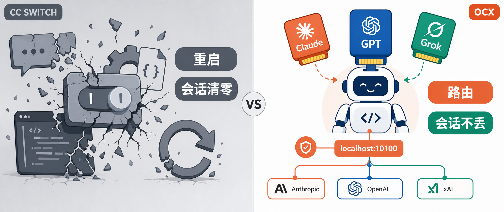

# ocx 换掉 cc switch，远离丢会话和重启两大痛

> 系列：**Agent Coding 工具与技巧**
> 整理：2026-07-22 · OpenCodex（`@bitkyc08/opencodex`，CLI 名 `ocx`）
> 对标：CC Switch 类配置切换器



额度快用完了，想从 A 站切到 B 站。于是你打开 cc switch，点了一下切换。

然后客户端重启了。你跑到一半的重构、调试上下文，整个没了。

这是 cc switch 用户最深的痛——不是"有点烦"，是"心碎"。而 ocx 换掉 cc switch，要解决的就是这两件事：

1. 换 provider 丢会话
2. 换模型必须重启客户端

---

## ① 一张卡 · Summary

| 字段 | 内容 |
|------|------|
| **工具** | OpenCodex（CLI 名 `ocx`） |
| **项目地址** | https://github.com/lidge-jun/opencodex |
| **文档站** | https://lidge-jun.github.io/opencodex/ |
| **npm** | `@bitkyc08/opencodex`（`npm install -g @bitkyc08/opencodex`） |
| **是什么** | 本机常驻的 **provider 代理**：CLI 永远指 `localhost:10100`，换模型只在代理内换路由 |
| **不是什么** | 不是配置管家，不靠改写各 CLI 的配置文件工作 |
| **核心设计** | **协议翻译运行时**：Codex Responses API ↔ 各家 LLM；Claude Messages 入站再路由 |
| **对标 cc switch 的痛** | cc switch 改配置 → 必重启 → 进程死 → 会话清零；ocx 切的是路由，进程不动 |
| **官方背书** | README 原文 "no restart needed"；"history-safe injection, ongoing chat history is never remapped" |
| **额外能力** | ChatGPT 账号池 / 429 冷却切号；`ocx claude` 网关模型发现（`claude-ocx-<provider>--<model>`） |
| **装法** | `npm i -g @bitkyc08/opencodex` → `ocx init` → `ocx start` |
| **许可** | 开源 · 仓库热度约 **2.4k+ star**（2026-07 查询） |
| **一句话** | **cc switch 切的是配置文件，一切就得重开、上下文清零；ocx 切的是请求路由，换脑不搬家，整个工作会话原样保留。** |

---

## ② 复制即用 · 给 Agent 的安装到起服务 Prompt

下面整段可直接粘贴给 Claude Code / Codex / Cursor / 任意 coding agent。
**只改尖括号里的占位符**，不要把真实 Key 写进仓库或聊天记录截图。

````markdown
# 任务：在本机从零安装并启动 opencodex（ocx），直到 Codex 请求成功走代理

你是运维向的 coding agent。按顺序执行，每步验证后再进入下一步。不要跳过检查。不要把 API Key 写入 git 跟踪文件或提交。

## 项目与文档（以官方为准，配置前先打开核对）
- **GitHub 主仓库**：https://github.com/lidge-jun/opencodex
- **文档站**：https://lidge-jun.github.io/opencodex/
- **npm 包**：https://www.npmjs.com/package/@bitkyc08/opencodex
- **默认代理地址**：`localhost:10100`
- 安装/配置命令若与本文不一致，**以仓库最新 README 为准**。

## 目标验收（全部满足才算完成）
1. `which ocx` 能找到命令
2. `ocx --version` 能打印版本
3. `ocx start` 已起代理，`http://localhost:10100` 可访问（dashboard 能打开）
4. 至少配好一个 provider（Anthropic / OpenAI / 其它 OpenAI 兼容网关）
5. Codex 已被注入指向代理（`openai_base_url` 指向 ocx）或用 `ocx claude` 起一个全连线的 Claude Code
6. 最后用中文向我汇报：项目地址、版本号、已配 provider/model、代理地址、三条常用命令、注意事项

## 前置
- 需要 Node.js ≥ 18（推荐 nvm/fnm 自管 Node，避免 `sudo npm install -g`）
- Bun 运行时随包自动安装，无需单独装 Bun
- 用户会提供 provider 的 API Key 或登录态；若用户未提供：停下来索要，**禁止伪造 Key**
- 不确定 flag/配置项时：优先查阅 https://github.com/lidge-jun/opencodex 的 README

## Step 1 — 安装 CLI
```bash
npm install -g @bitkyc08/opencodex
```
验证：
```bash
which ocx
ocx --version
```
若 npm 提示 "bundled Bun runtime is missing"（npm 拦了 bun 的 postinstall）：
```bash
npm install -g --allow-scripts=bun @bitkyc08/opencodex
```

## Step 2 — 初始化（写配置 + 注入 Codex + 可选装自启 shim）
```bash
ocx init
```
交互式：写配置文件、把 Codex 的 `openai_base_url` 指向自己、询问是否装按需自启 shim。
若 init 时跳过了 shim，之后补装：
```bash
ocx codex-shim install
```

## Step 3 — 启动代理
```bash
ocx start
```
代理跑在 `http://localhost:10100`（端口被占会自动 fallback 到空闲端口）。
验证 dashboard 能打开；从这里加 provider、配 Claude slots、看账号池。

## Step 4 — 加一个 provider
最方便的是在 dashboard（`http://localhost:10100`）里加。也可命令行配。
- Anthropic（走官方或 OAuth/Key）
- OpenAI（Codex 登录 或 API Key）
- 任意 OpenAI 兼容网关（填 BASE_URL + Key）

加完即可用，**no restart needed**。

## Step 5 — 让 Codex / Claude 走代理
**Codex**（init 已注入，直接用）：
```bash
codex "Write a hello world in Rust"
codex -m "anthropic/claude-opus-4-8" "Explain this stack trace"   # 显式指定 provider/model
```
省略 `provider/` 前缀时，ocx 按模型名自动路由（`claude-*`→Anthropic，`gpt-*`→OpenAI）。

**Claude Code**（同一个 daemon 同时服务 Messages API）：
```bash
ocx claude
```
起一个全连线的 Claude Code，路由的模型以 `claude-ocx-<provider>--<model>` 别名出现在 Claude 原生 `/model` 选择器里（需 Claude Code 2.1.129+）。

## Step 6 —（可选）ChatGPT 账号池
在 dashboard 加多个 Codex / ChatGPT 账号，按 5h / weekly / 30d 配额自动选最低用量的健康号；
某号触发 429 自动冷却、故障转移到池里另一个号；
长会话 pin 在起头的账号上，不会跑到一半跳号。

## 约束
- 不要在对话中回显完整 API Key
- 不要 commit ocx 的配置文件（含 Key）
- 额度紧时优先用池 + 故障转移，而不是手动切号
- ocx 更新频繁，升级前留意 changelog，可能有 breaking
- 公司代码过本机代理需自行评估合规与 ToS 风险

## 交付给我的报告模板
- 项目地址：https://github.com/lidge-jun/opencodex
- ocx 版本：
- 安装路径：
- 代理地址：localhost:10100
- 已配 Provider / Model：
- Codex 注入状态：已注入 / 待注入
- 三条我以后可复制的命令：
- 风险与坑：
````

**给人类的最短口令（不调 Agent 时自己敲）：**

```bash
npm i -g @bitkyc08/opencodex
ocx init
ocx start
# dashboard: http://localhost:10100 加 provider，加完即用，no restart needed
```

---

## ③ 详细介绍

### 1. 两大痛，先说清楚痛在哪

**痛一：一切 provider，会话没了。**

cc switch 的切换动作，本质是改写 CLI 的配置文件 / 环境变量。你点切换，它把 `BASE_URL` 和 Key 换成 B 站那套。

问题在于——客户端读配置是一次性的，读完就缓存进内存。所以配置改了，客户端不会热加载，**必须重启进程，新配置才生效**。

而重启进程，意味着那个活着的 agentic 运行时状态全清零：MCP 连接断了、后台跑着的 bash 没了、内存里的 todo 没了、跑到一半的工具调用没了。你正深入任务、额度正好用完、想换个脑继续干——恰恰这一刻，cc switch 逼你清台重来。

时间点本身就是论点：你换 provider 的时候，就是你最不该被打断的时候。

> 严格说，对话文本不是永久丢。Claude Code 有 `--resume`，Codex 有 thread。但 `--resume` 只能重建对话文本，重建不了活的进程状态——MCP 连接、后台进程、跑到一半的 diff，这些回不来。对正跑长任务的人，丢的是后者，这才是真痛。

**痛二：换模型，又得重启客户端。**

同一种痛的另一个面。想从 GPT 换成 Claude 试试、或者 Claude 换成 Grok 省点额度——cc switch 改的还是配置，所以还是得重启客户端，新模型才认。一天里为了换脑重开三四次客户端，工作流被打成碎片。

---

### 2. 为什么 cc switch 必然这样

这两痛不是 cc switch 的 bug，是它的**产品形态决定的**。

cc switch 是一个配置管家：它的全部工作，就是把各套 `BASE_URL`/Key 写进各 CLI 的配置文件，你一切换 = 换配置文件。而"改配置 → 重启 → 进程死 → 状态清零"是一条必然的因果链，只要形态是"改配置"，这条链就躲不掉。

这不是 cc switch 做得差。它是配置切换器，做得再好，也只能优化"切得快不快"，优化不掉"切了得重启"这件事本身。

---

### 3. ocx 怎么做到不痛

ocx 换了个范式：**不是改配置，是跑一个本地代理。**

你的 CLI 永远指向 `localhost:10100` 这个常驻代理。换 provider、换模型，都只是在**代理内部换路由**——客户端进程根本不动，它甚至不知道后台换了脑。

于是：

- **换 provider，会话不丢**：客户端进程没死，MCP 连接、后台任务、内存里的 todo、跑到一半的工具调用，全活着。ocx 官方把这叫 "history-safe injection"——连聊天历史都不会被重映射，uninstall 都藏不住。
- **换模型，不用重启**：代理里改路由就行。README 原文写 provider 添加完"immediately ready, no restart needed"——添加即生效。

这就是"换脑不搬家"那句叙事的来源：**Codex 当身体，模型当大脑，换脑的时候身体不动。**

---

### 4. 顺带还有几把刷子（cc switch 不做的）

一旦范式从"改配置"换成"跑代理"，很多 cc switch 做不到的事自然就来了：

**账号池 / 429 自动切号。** 多个 ChatGPT 账号做池，按 5h / weekly / 30d 配额自动选最低用量的健康号；一个号触发 429，自动冷却、故障转移到池里另一个号。长会话还会 pin 在起头的那个账号上，不会跑到一半跳号。这一条甚至让你**连"手动换 provider"这步都省了**——额度紧，代理自己换。

**Claude 网关发现。** `ocx claude` 把 Claude Code 指向同一个代理，路由的模型会以 `claude-ocx-<provider>--<model>` 的别名出现在 Claude 原生 `/model` 选择器里，自动列出。你不用记模型 ID，在 Claude 里直接选。

**双端一体。** Codex 的 Responses API 和 Claude 的 Messages API，进的是同一个代理。一个本地 daemon，同时喂两端，协议翻译在中间自动做。

---

### 5. 一个诚实的边界

不是所有人都该换。cc switch 没死，它在自己的赛道上仍是最好的：

- 你只想**点 GUI 管多套 Key**、不碰协议、看不懂 Responses/Messages 是什么——cc switch 更省心，托盘点一下就切。
- 你要的是 **MCP / Skills 批量管理**、多 CLI 配置一锅炖——cc switch 主打这个，ocx 不碰。
- 你要的是"今天 A 站明天 B 站，点一下启用"那个**切供应商心智**——cc switch 就是为此生的。

但如果你的痛是"一切就丢会话、一换就重启"，而你又愿意接受一个常驻本地代理——那 ocx 是直接对症的解法。

**一句话：cc switch 切的是配置文件，一切就得重开、上下文清零；ocx 切的是请求路由，CLI 永远指本地代理，换脑不搬家，整个工作会话原样保留。**

---

## ④ 信息来源

以下为撰写时核对过的一手来源；star 数与版本会变动，以页面实时为准。

| 来源 | 用途 | 链接 |
|------|------|------|
| 官方 GitHub 仓库 README | 产品定义、架构、安装、命令、账号池、Claude 网关发现 | https://github.com/lidge-jun/opencodex |
| 文档站 | 完整文档 | https://lidge-jun.github.io/opencodex/ |
| npm 包 | 包名、版本、描述 | https://www.npmjs.com/package/@bitkyc08/opencodex |
| GitHub 元数据（查询日约 2026-07-21） | 描述、TypeScript、star 量级约 2.4k+、pushed 2026-07-21 | `gh api repos/lidge-jun/opencodex` |

**写作边界说明**

- 文中 "no restart needed"、"history-safe injection, ongoing chat history is never remapped"、账号池 429 冷却/故障转移/pin 长会话、`claude-ocx-<provider>--<model>` 别名、`localhost:10100`、`ocx init/start/claude/codex-shim` 等均为**官方 README 公开表述**，非本文独立测评。
- 未宣称 ocx 全面碾压 cc switch；对比仅限**形态与适用场景**。cc switch 在中文圈存在多个同名/衍生项目，本文指"配置切换类工具"这一产品形态。
- 安装与配置命令以官方文档为准；若上游改 flag，以仓库最新 README 覆盖本文。
- "`--resume` 只能重建对话文本，重建不了活的进程状态"为合理技术推断；如需严谨可自行验证。

---

 有话说

> **cc switch 切的是配置，一切就得清零重来；ocx 切的是路由，身体不动、只换脑——换脑不用搬家。**

企业 AI 生产力管理平台 · ai.ziikoo.com
