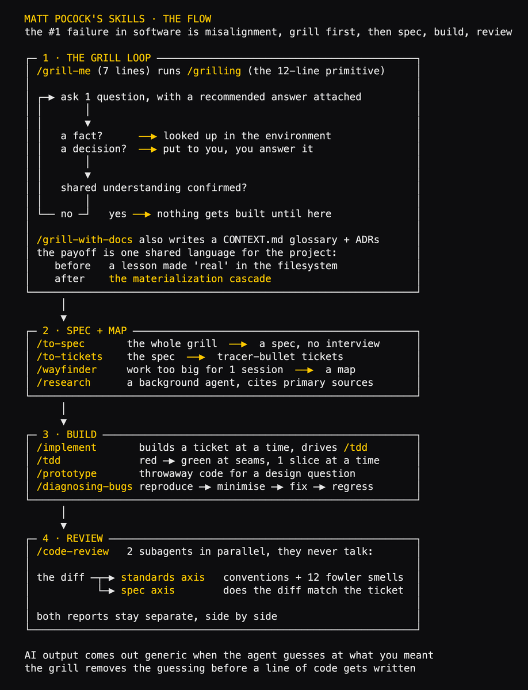
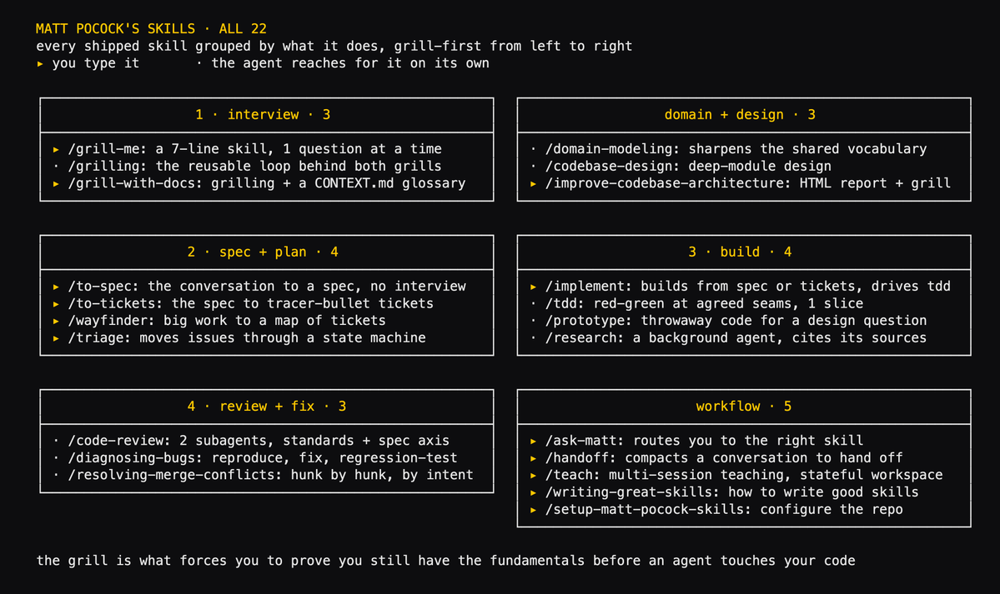
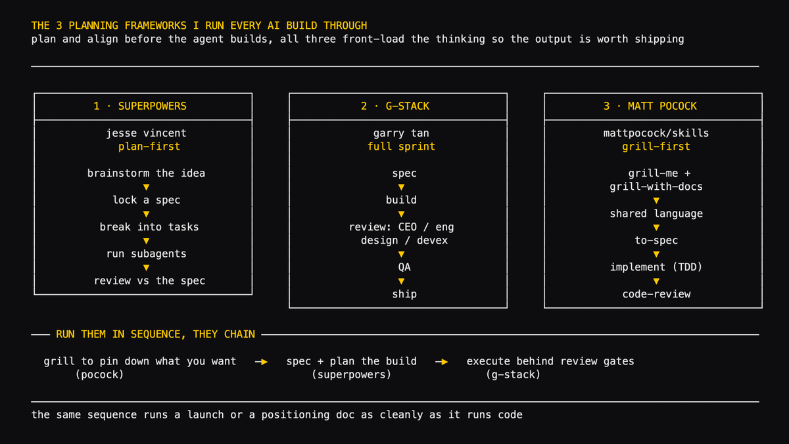

# how @mattpocockuk's 7-line skill bundle improve AI context gathering

its a grill-first workflow for Claude Code (or any other harness), it interview you before agents start working on your codebase to ensure you have the most accurate context

every skill, and what it does:

## interview

> **/grill-me**: a 7-line skill that interviews you 1 question at a time until every decision is resolved  
> **/grilling**: the reusable loop behind grill-me and grill-with-docs  
> **/grill-with-docs**: the same grill, and it builds a CONTEXT .md glossary and ADRs as you go

## domain and design

> **/domain-modeling**: sharpens the project's shared vocabulary and glossary  
> **/codebase-design**: deep-module design, a simple interface that hides deep functionality  
> **/improve-codebase-architecture**: scans for architecture opportunities, writes an HTML report, then grills the one you pick

## spec and plan

> **/to-spec**: collapses the conversation into a spec, no interview, publishes it to your tracker  
> **/to-tickets**: breaks the spec into tracer-bullet tickets, each declaring what blocks it  
> **/wayfinder**: splits work too big for 1 session into a set of investigation tickets on your tracker  
> **/triage**: moves issues through a state machine of triage roles

## build

> **/implement**: builds from the spec or tickets, drives TDD, closes with code-review  
> **/tdd**: red-green at agreed seams, 1 vertical slice at a time  
> **/prototype**: throwaway code to answer a design question  
> **/research**: a background agent investigates against primary sources, leaves a cited file

## review and fix

> **/code-review**: 2 parallel subagents report side by side, 1 on your standards, 1 on the spec  
> **/diagnosing-bugs**: reproduce, minimise, hypothesise, instrument, fix, regression-test  
> **/resolving-merge-conflicts**: resolves conflicts hunk by hunk, by intent

## workflow

> **/ask-matt**: routes you to the skill or flow that fits your situation  
> **/handoff**: compacts a conversation into a doc for the next agent or session  
> **/teach**: multi-session teaching, the directory as a stateful workspace  
> **/writing-great-skills**: a reference for writing and editing skills  
> **/setup-matt-pocock-skills**: configures the repo, run once

## the value it brings builders

grilling comes first. /grill-me and /grill-with-docs interview you 1 question at a time until you've signed off on every decision. only then does /to-spec write the spec, /to-tickets break it up, /implement build it, and /code-review check it twice

---

## Quoted post

**url:** https://x.com/shannholmberg/status/2076033805241249895  
**author:** Shann³ (@shannholmberg)  
**created_at:** 2026-07-11T20:00:04Z  
**engagement:** likes 194 · reposts 18 · quotes 5 · replies 19 · bookmarks 243 · views 37797

the 3 planning frameworks I run every AI build through

each one forces the same discipline, you plan and align before the agent builds

### 1. superpowers (jesse vincent)

a skill framework for claude code that makes you plan before you build, it works on anything, code or a campaign

the superpowers pipeline:

> brainstorm the idea, surface the requirements  
> lock a spec before anything gets built  
> break the work into small tasks  
> run subagents in parallel, one per task  
> review everything against the spec

a dev never codes without a spec, and superpowers brings that same discipline to marketing, the brief, the task list, and the review in one flow

### 2. g-stack (garry tan)

full sprint in one methodology, spec all the way to production (even good at monetisation), with its own 23+ specialist skills

the g-stack sprint:

> spec the work, then build it  
> review it through separate lenses, CEO, eng, design, devex  
> QA it, then ship  
> each lens catches what the others miss

nothing reaches production without passing a reviewer first

### 3. matt pocock's skills

grill-first, it interviews you before it builds anything

the pocock grill loop:

> grill-me and grill-with-docs question you until every decision is resolved  
> you and the agent end up using the same words for the same things  
> then to-spec, implement with TDD, and code-review

the grilling avoids misalignment, the reason AI output comes out generic is usually the agent guessing

run them in sequence, pocock's grilling first so you know what you want, then superpowers or g-stack to plan and ship it. the same order runs a launch or a positioning doc as cleanly as it runs code

---

## Sample replies (context)

- **@ajs6888**: 先把人问明白，比一上来改代码靠谱多了  
- **@iamanikethv**: Using this framework Claude = having a boss on your shoulder 24/7 😅 #AI / But I get the direction this is pointing towards 👏  
- **@0xTreff**: does the grill-me flow work if youre still fuzzy on the problem, or do you need a rough idea first?
