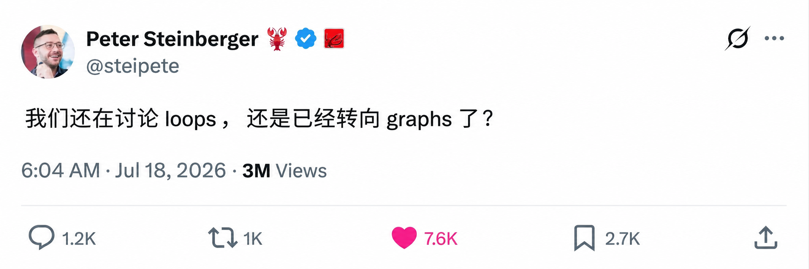
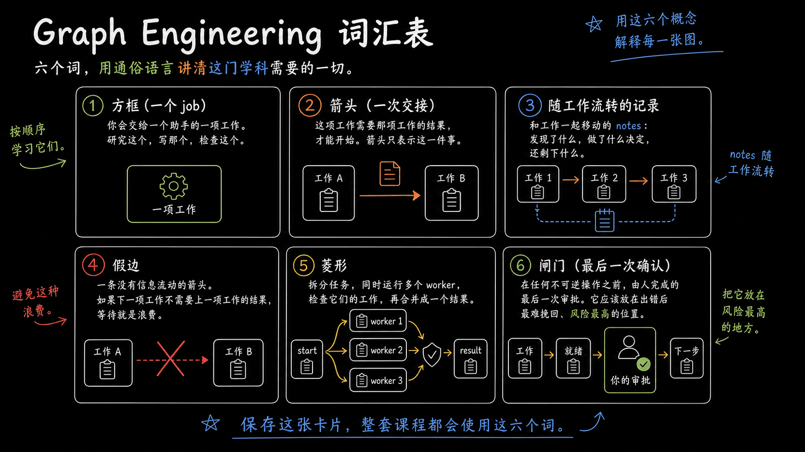
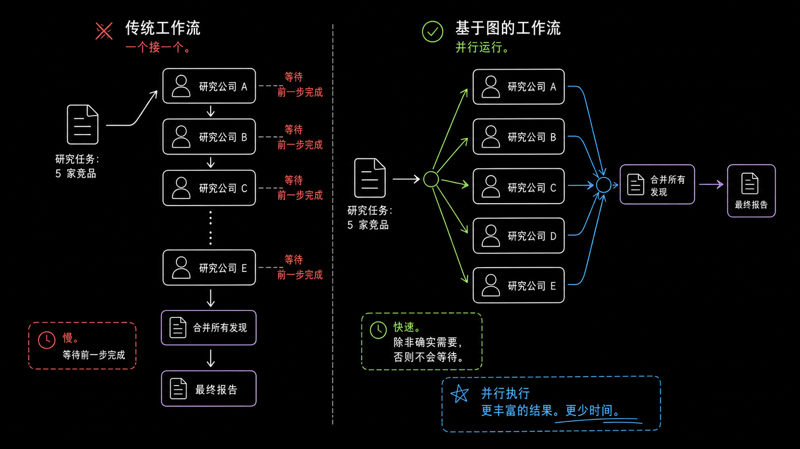
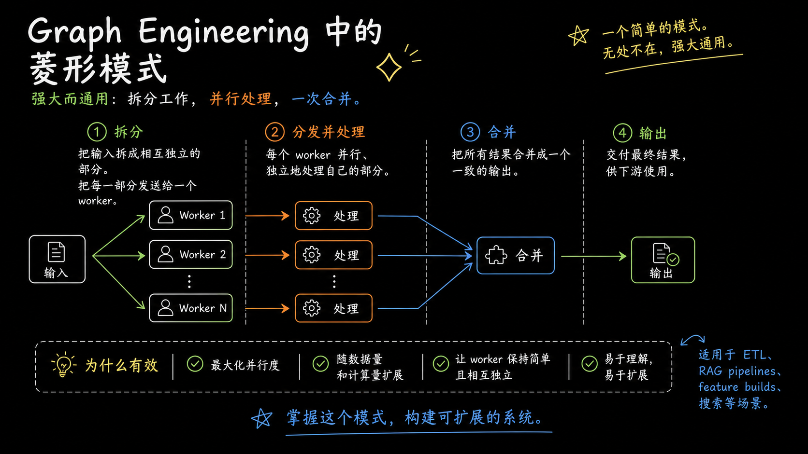
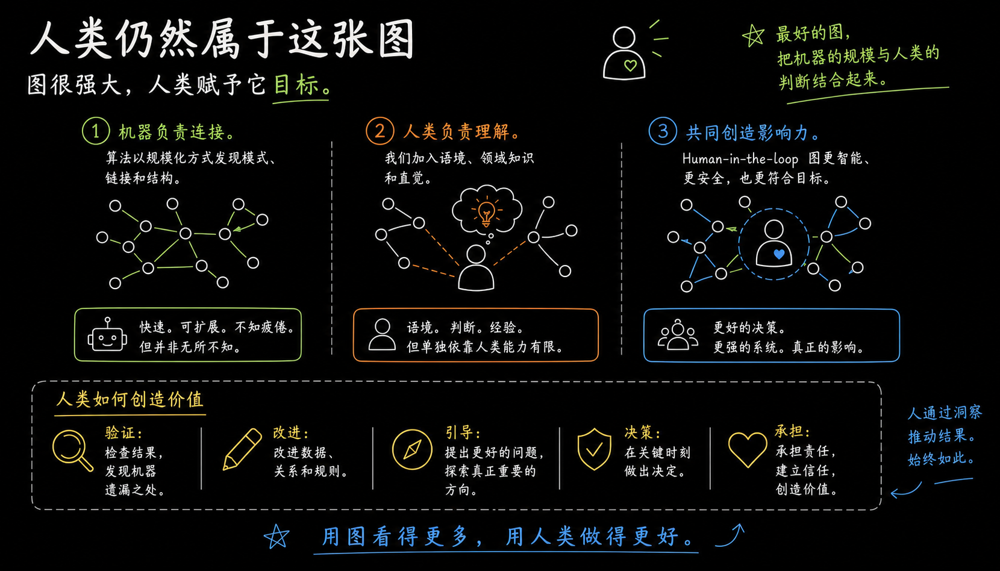

# 图工程：下一次 AI 革命

大家好，我是 wandermist——这篇我差点没发。

所有人都在谈 AI 智能体。几个月前，最火的技能还是提示词工程。接着是循环工程（loop engineering）：让模型反复改进自己的产出。今天，讨论又在转向。最强的 AI 系统，不再是一次对话，也不是无尽循环，而是图（graph）。

这不只是又一个 buzzword。它是一种不同的思考方式：AI 如何解决问题。

## 线性 AI 的问题

多数人仍把 AI 当成一个员工来用。

- 你提问
- 模型思考
- 它回答

简单任务够用。但真实工作很少这么直来直去。

想象写一份市场研究报告：有人收集竞品数据，有人研究用户行为，有人核对数字，最后有人在发布前做总审。把这些职责都塞进一次 AI 对话，就像让一个人同时身兼数职。能做，但很难扩展。

这正是图工程（Graph Engineering）要解决的问题。

## 什么是图工程？

图工程是一种实践：把 AI 工作流设计成互联网络，而不是一条直线流水线。

图中每个节点只负责一件事。一个节点做调研，一个写稿，一个校验来源，另一个决定下一步走哪条路径。节点之间的连接，定义信息如何在系统中流动。

你不是让一个 AI 包办一切，而是在组建一支协作团队，每个成员职责清晰。

结果不只是执行更快。你会得到更易理解、调试、改进和扩展的系统。

## 为什么图很重要

图结构系统的一大优势是并行执行。

假设要调研五家竞品。

传统工作流会先做 A 公司，再做 B，再做 C……每一步都要等上一步结束。

图结构可以同时启动五个调研节点。结果齐了之后，再由另一个节点汇总成一份报告。

只有真正需要等待时，才等待。

这一个设计决策，往往就能大幅缩短执行时间，同时产出更丰富。

## 不是每条箭头都该存在

构建 AI 系统时，最容易犯的错之一，是把彼此并不依赖的步骤硬连在一起。

很多工作流之所以被串行化，只是因为当初就按串行画的。

如果「总结 PDF」和「查明天日程」毫无关系，为什么一个要等另一个？

图工程逼你只问一个简单问题：

这个任务真的依赖前一步的结果吗？

如果答案是「不」，依赖就该删掉。

去掉这些「假边」，对工作流的改进，常常比再加一个模型还大。

## 菱形模式

随着图结构 AI 系统越来越常见，一种架构反复出现。

工作流先从规划开始。

然后分叉成多个并行工作者，各自从不同角度探索。

接着是校验：独立智能体挑战已有结论，而不是照单全收。

最后，一切合并成单一答复。

这个模式常被称为菱形架构（Diamond Architecture）。它其实就是人类做了几十年的事。

- 研究
- 评审
- 合并

系统不再轻信第一个答案，而是先制造分歧，再达成共识。

这一步很简单，却能显著提高输出可靠性。

## 校验比生成更有价值

生成内容已经很容易。

信任内容仍然很难。

关于 AI 最大的误解之一，是假设同一个模型就该审核自己的工作。

实际上，独立校验几乎总是更稳。

专职审核者可以追问：

- 信息是否事实正确？
- 来源是否仍然时效？
- 这条建议是否真正回应了原始目标？

不同审核者应挑战工作的不同侧面。

准确性。

时效性。

逻辑。

证据。

图工程把「创造」与「校验」拆开，让整个系统更可靠。

## 更多智能体 ≠ 更好结果

很多构建者就是栽在这里。

如果每一步都依赖上一步，再堆智能体通常只增加复杂度，却不提升表现。

图结构只有在工作天然可拆成独立部分时，才会真正发挥优势。

如果流程必须串行，一个能力够强的智能体，往往比十个协调中的智能体更有效。

问题从来不是：

「我该加多少智能体？」

更好的问题是：

「工作在哪里天然分叉？」

## 人仍然属于这张图

目标不是去掉人，而是把人放在价值最大的位置。

- 发布文章
- 发送客户邮件
- 批准金融交易
- 上线产品

这些如果盲目自动化，代价很高。最聪明的 AI 系统不会取消人类判断，而是把判断留给最关键的决策。

其余都可以自动发生。

## 图工程本质上是系统设计

说到底，图工程不关于「图」本身，而关于像系统设计者一样思考。

- 每个节点只有一个职责
- 每条连接都有理由
- 每次评审都有目的
- 每次审批都有成本

当这些原则合在一起，AI 就不再像聊天机器人，而开始像一支协作团队。

这才是今天真正发生的转变。

提示词工程教我们如何与模型沟通。

循环工程教我们如何通过迭代改进推理。

图工程教我们如何协调智能。

随着 AI 系统更大、更自主、更深地嵌入业务，设计工作流——而不是只写提示词——可能成为现代 AI 中最有价值的能力之一。

如果这篇对你有用，关注 [@wandermist](https://x.com/@wandermist)，会有更多类似内容。
