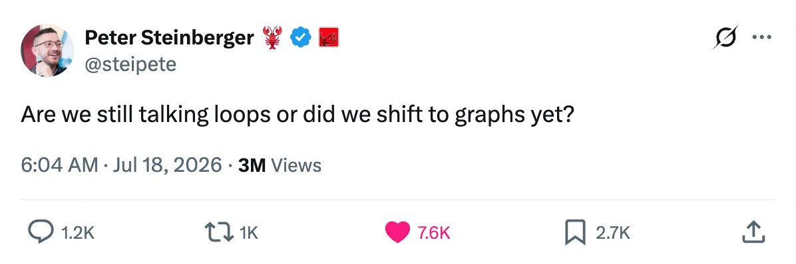
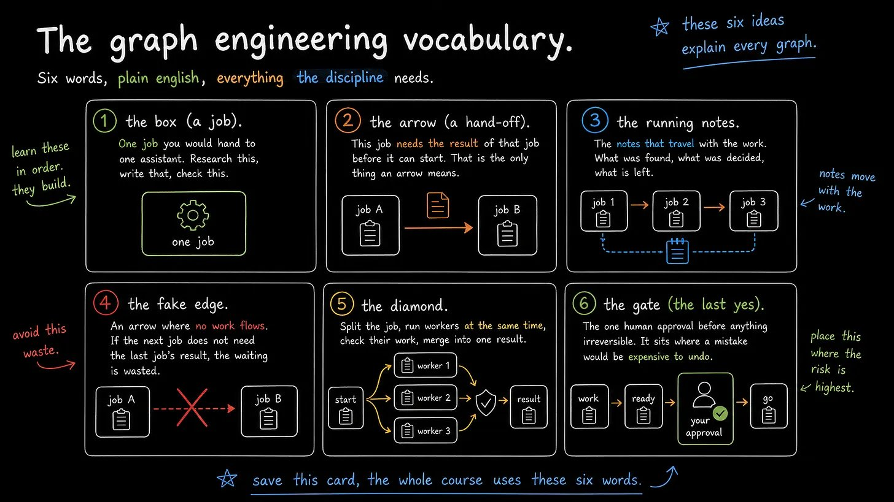
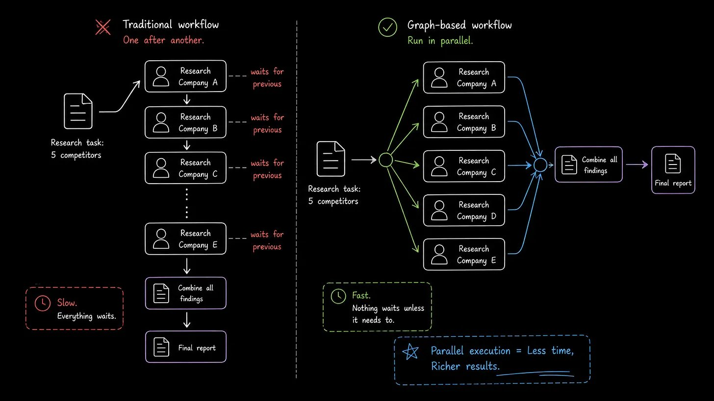
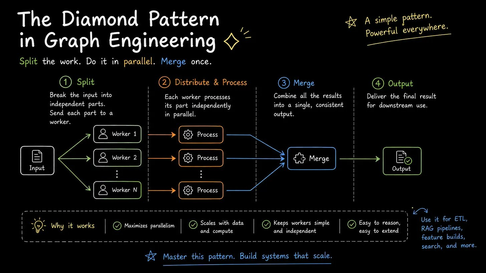
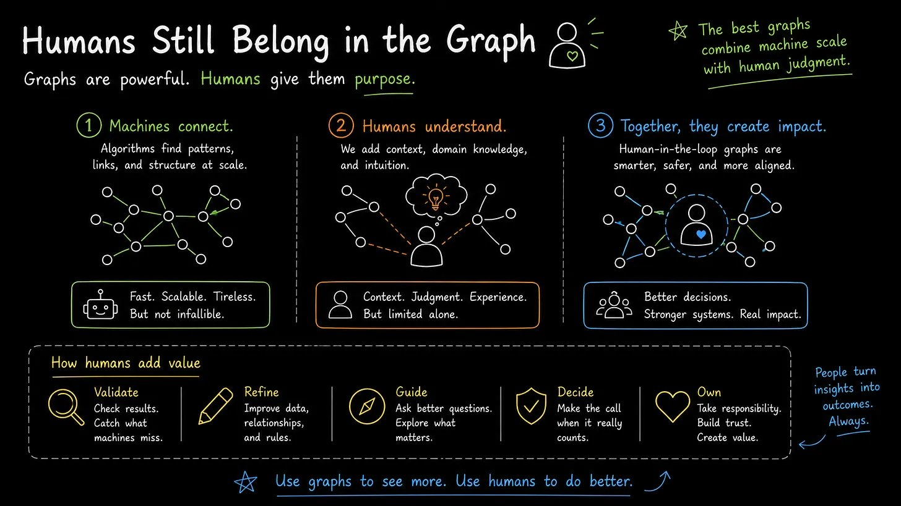

# Graph Engineering: The Next AI Revolution

Hello everyone, wandermist here and I almost didn't post this!

Everyone is talking about AI agents. A few months ago, prompt engineering was the hottest skill. Then came loop engineering, where AI models could repeatedly improve their own work. Today, the conversation is shifting again. The most capable AI systems are no longer built as a single conversation or an endless loop. They are built as graphs.

This shift isn’t just another buzzword. It’s a different way of thinking about how AI solves problems.

## The Problem with Linear AI

Most people still use AI like a single employee.

- You ask a question
- The model thinks
- It responds

For simple tasks, that’s enough. But real work is rarely that straightforward.

Imagine preparing a market research report. One person gathers competitor data, another studies customer behavior, someone verifies the numbers, and, finally, a manager reviews everything before publishing. Running all of those responsibilities through a single AI conversation is like asking one person to wear every hat at once. It works, but it doesn’t scale well.

This is exactly where Graph Engineering comes in.

## What is Graph Engineering?

Graph Engineering is the practice of designing AI workflows as connected networks instead of straight pipelines.

Each node in the graph performs one specific responsibility. One node may research, another writes, and another validates sources, while another decides which path to take next. The connections between these nodes define how information flows through the system.

Instead of asking one AI to do everything, you’re building a coordinated team where every member has a clear responsibility.

The result isn’t simply faster execution. It creates systems that are easier to understand, debug, improve, and scale.

## Why Graphs Matter

One of the biggest advantages of graph-based systems is parallel execution.

Imagine researching five competitors.

A traditional workflow researches Company A, then Company B, then Company C, and so on. Every task waits for the previous one to finish.

A graph launches five researchers simultaneously. Once all findings arrive, another node combines the results into a single report.

Nothing waits unless it actually needs to.

That single design decision can reduce execution time dramatically while producing richer outputs.

## Not Every Arrow Should Exist

One of the easiest mistakes when building AI systems is connecting steps that don’t actually depend on each other.

Many workflows become unnecessarily sequential simply because they were designed that way.

If summarizing a PDF has nothing to do with checking tomorrow’s calendar, why should one wait for the other?

Graph engineering forces you to ask a simple question:

Does this task truly depend on the previous result?

If the answer is no, the dependency disappears.

Removing these “fake edges” often improves a workflow more than adding another AI model.

## The Diamond Pattern

As graph-based AI systems become more common, one architecture appears repeatedly.

The workflow begins with a planning step.

It then splits into multiple parallel workers, each exploring a different angle.

Next comes verification, where separate agents challenge the findings rather than accepting them blindly.

Finally, everything merges into a single response.

This pattern is often called the Diamond Architecture, and it captures something humans have practiced for decades.

- Research
- Review
- Merge

Instead of trusting the first answer, the system creates disagreement before reaching agreement.

That simple addition makes outputs significantly more reliable.

## Verification Is More Valuable Than Generation

Generating content has become easy.

Trusting it has not.

One of the biggest misconceptions about AI is assuming that the same model should review its own work.

In reality, independent verification consistently performs better.

A dedicated reviewer can ask questions like:

- Is this information factually correct?
- Are the sources still current?
- Does this recommendation actually answer the original objective?

Different reviewers should challenge different aspects of the work.

Accuracy.

Freshness.

Logic.

Evidence.

Graph Engineering separates creation from validation, making the overall system much more dependable.

## More Agents Don’t Always Mean Better Results

This is where many builders go wrong.

If every task depends on the previous one, adding more agents usually increases complexity without improving performance.

Graphs excel only when work naturally branches into independent pieces.

If a process must remain sequential, one capable agent often performs better than ten coordinated ones.

The question is never:

“How many agents should I add?”

The better question is:

“Where does the work naturally split?”

## Humans Still Belong in the Graph

The goal isn’t removing humans. It’s placing them where they create the most value.

- Publishing an article
- Sending a customer email
- Approving a financial transaction
- Launching a product

These are expensive mistakes if automated blindly. The smartest AI systems don’t remove human judgment. They reserve it for the decisions that matter most.

Everything else can happen automatically.

## Graph Engineering is Really About System Design

At its core, Graph Engineering isn’t about graphs. It’s about thinking like a systems designer.

- Every node has one responsibility
- Every connection has a reason
- Every review has a purpose
- Every approval has a cost

When those principles come together, AI stops behaving like a chatbot and starts behaving like a collaborative team.

That’s the real shift happening today.

Prompt engineering taught us how to communicate with models.

Loop engineering taught us how to improve reasoning through iteration.

Graph Engineering teaches us how to coordinate intelligence.

And as AI systems become larger, more autonomous, and increasingly integrated into businesses, that ability to design workflows instead of prompts may become one of the most valuable skills in modern AI.

If this was useful - follow [@wandermist](https://x.com/@wandermist) for more content like this!